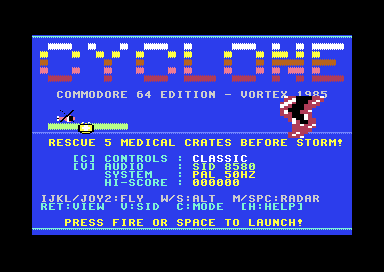
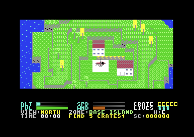

# Cyclone — Commodore 64 Edition

A native **Commodore 64 (stock 64 KB, PAL & NTSC)** port of the 1985 ZX Spectrum 3D helicopter rescue classic **Cyclone** (Costa Panayi / Vortex Software), built from a clean-room reverse engineering of the original Z80 archipelago map and gameplay logic and re-engineered in C ([Oscar64](https://github.com/drmortalwombat/oscar64)) to take full advantage of C64 **VIC-II** graphics and **SID** audio.

| Title Screen | 3D Tropical Archipelago |
|---|---|
|  |  |

| 320×200 Bitmap Tactical Radar | Raging Cyclone Tempest |
|---|---|
|  |  |

---

## What This Is

- **Authentic 1985 World Data**: Extracts the exact **768 × 768** 14-island tile atlas, 3D vertical slice stacks, and North/South viewpoint geometry directly from the original ZX Spectrum release (documented in [docs/gameplay_spec.md](docs/gameplay_spec.md)).
- **True C64 Hardware Showcase (Single-Load 50 KB `.prg`, No Cartridges or Expansions)**:
  - **50/60 Hz 8-Way Hardware Scrolling**: Double-buffered VIC-II Multicolor playfield with unrolled 18-row Color RAM shifting and a 5-stage FLD raster IRQ split locking a 4-row Hi-Res Cockpit HUD across both PAL and NTSC.
  - **8-Layer Hardware Sprites (62 Static Frames under I/O `$D000–$DFFF`)**: Hi-Res spinning rotor (Sprite 0) layered *in front of* a 16-angle Multicolor helicopter fuselage (Sprite 1), Dark Grey terrain-hugging 3D ground shadow (Sprite 2), animated winch cable (Sprite 3), 2× swirling red Cyclone funnel & storm rain / low-flying jets (Sprites 4–5), and pulsing medical crates & waving survivors (Sprites 6–7).
  - **True 320×200 VIC-II Bitmap Tactical Radar (`M` / `Space`)**: Switches VIC-II into Hi-Res Bitmap Mode (`BMM=1`, `$E000–$FF3F`) by temporarily backing up active charsets into `$C000/$C400` and restoring them losslessly on exit — rendering all 14 pixel-accurate coastlines, 7 white helipad crosses, a 3×3 sector grid, and live pulsing sprites in ~0.15 s.
  - **3-Voice Filtered SID Audio (MOS 6581 & 8580 Auto-Calibrated)**: Auto-detects the SID revision at boot to calibrate filter cutoffs across both chips — Voice 1 synthesizes speed-coupled rotor blade thumps, Voice 2 drives resonant Cyclone wind & rolling low-pass thunder, and Voice 3 handles priority SFX (winch servo, crate/survivor chimes, Doppler jet flybys, low-fuel klaxon, crash explosions, and fanfares), plus an original 3-voice SID title theme and radar sonar pings.

---

## Mission & How to Play

1. **Take off** from the Base Island helipad (`W` or `Fire + Up`).
2. **Recover all 5 Medical Crates** hidden across outer islands (hover low and slow over a flashing crate or waving **Survivor** to automatically deploy the winch) before the **08:00** countdown expires.
3. **Watch your fuel (`FUL`) and the Cyclone (`WND`)**: Use the live **320×200 Tactical Radar (`M` / `Space`)** to track the storm and plan refueling stops at any of the 7 white island helipads (`BASE`, `KOKOLA`, `PEAK`, `GILLIGANS`, `RED`, `SKEG`, `ENTERPRISE`).
4. **Return to Base Island** and land gently on its helipad with all 5 crates to win.

### Controls

| Input | Action |
|---|---|
| **Joystick Port 2** or **`I` / `J` / `K` / `L`** | Fly helicopter (Classic rotate+thrust or Direct 8-Way Arcade mode) |
| **Fire + Up / Down** or **`W` / `S`** | Climb / Descend altitude |
| **Quick-tap Fire** or **`Return`** | Flip 3D Camera View (`NORTH` ↔ `SOUTH`) |
| **`M`** or **`Space`** | Open / Close 320×200 Bitmap Tactical Radar Map |
| **`C`** | Toggle Control Mode (`CLASSIC` / `ARCADE`) |
| **`V`** | Toggle SID Audio Mute (Title Menu & in-flight) |
| **`H`** | Open Controls & Mission Help Screen (Title Menu & in-flight) |
| **`1`–`7`** | Quick-warp to the 7 helipad islands |
| **`T`** / **`Run/Stop`** *(after Win / Game Over)* | Return to Title Screen |

---

## Stock 64 KB C64 Memory Map

| Address Range | Contents |
|---|---|
| `$0801 – $4FFF` | Startup stub + Core 3D engine, scroller, helicopter physics, entities, HUD & SID audio |
| `$5000 – $9AFF` | Full 19,200-byte dense 14-island tile atlas |
| `$9B00 – $BFFF` | 3D tile slice LUTs + Cyclone AI, 320×200 Bitmap Radar, Title & Help screens |
| `$C000 – $CBFF` | Boot-only LZO payloads (unpacked at startup, then reclaimed as Screen A, Screen B & HUD/Map Screen) |
| `$CC00 – $CFFF` | Compact bitmap primitives, upper data/BSS & stack |
| `$D000 – $DFFF` | Hardware I/O (CPU) / 4 KB Static Sprite Bank under I/O (VIC-II Bank 3) |
| `$E000 – $FF3F` | Tropical Multicolor Charset (`$E000`) & HUD Charset (`$F000`); temporarily serves as 8,000-byte Bitmap RAM during Tactical Map |

---

## Repository Layout

- `src/` — C64 C source files (`main.c`, `world.c`, `raster.c`, `scroller.c`, `helicopter.c`, `entities.c`, `cyclone.c`, `radar_map.c`, `hud.c`, `audio.c`, `title.c`, `memmap.h`, `test_hooks.inc`)
- `tools/` — Python asset & verification pipeline (`extract_spectrum.py`, `build_assets.py`, `build_sprites.py`, `run_tests.py`)
- `generated/` — Pre-built C64 charsets, sprite bank, tile tables, and dense archipelago atlas
- `extracted/` — Extracted Spectrum reference maps, JSON descriptors, and preview renders
- `docs/` — Reverse-engineered specification ([gameplay_spec.md](docs/gameplay_spec.md)), on-target testing plan ([testing_plan.md](docs/testing_plan.md)), and showcase screenshots

---

## Building, Running & Testing

Requires [Oscar64](https://github.com/drmortalwombat/oscar64), Python 3 (with Pillow), and [VICE](https://vice-emu.sourceforge.io/) (`x64sc`).

```bash
make all        # Build stock 64 KB single-load build/cyclone.prg (~50 KB)
make run        # Launch in VICE x64sc (PAL 50 Hz)
make run-ntsc   # Launch in VICE x64sc (NTSC 60 Hz)
make test       # Run 16-scenario on-target VICE visual, alignment & playability suite
make assets     # Regenerate C64 charsets, sprites & tile tables from extracted/
```

See [docs/testing_plan.md](docs/testing_plan.md) for details on the 16 automated on-target VICE tests (color stability, 8-way 720-cell Color RAM integrity, sprite/shadow/survivor alignment, fuel reachability, and full 5-crate mission win).

---

## License

Source code and tooling are released under the **BSD 3-Clause License** — see [LICENSE](LICENSE). Original *Cyclone* (1985) concept and archipelago design by Costa Panayi / Vortex Software.
